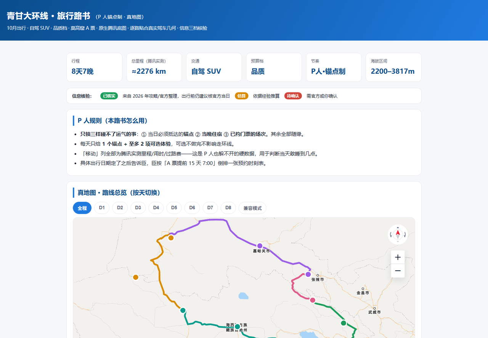

# 青甘大环线 · 旅行路书（进阶版）

一份可离线打开的青甘大环线自驾路书，**8 天 7 晚，总里程约 2276 公里（腾讯地图实测）**。

编排思路是「P 人锚点制」：不把每天的行程切成一格一格的时刻表，只锚定当天必须到达的几个关键点，中间怎么玩、玩多久，留给自己现场决定。适合不喜欢被行程表绑住、但又怕漏掉关键住宿点的人。

## 界面预览



一屏之内看完全程：顶部是行程概览（8 天 7 晚 / ≈2276 km / 海拔 2200–3817 m / 品质档），往下是「P 人规则」，再往下是可按天切换的真实路线地图（D1–D8 分段着色，绿→紫）。

## 页面里有什么

| 板块 | 内容 |
|---|---|
| P 人规则 | 这份路书怎么用：什么该提前定、什么可以到现场再说 |
| 真地图 · 路线总览 | 基于腾讯地图 GL 版的真实路线，可按天切换查看 |
| 10 月出行 · 季节要点 | 秋季走这条线的气候与路况提醒 |
| 每日行程 | 每天的关键锚点、住宿、可选项目（≤2 个）、实测移动时间、需预约项 |
| 预订清单 | 按提前天数倒排，什么时候该订什么 |
| 应急方案 | 高反、封路、爆胎、极端天气等应对 |

## 路线一览

| 天 | 行程 | 备注 |
|---|---|---|
| D1 | 西宁集合 | 抵达日，适应海拔 |
| D2 | 西宁 → 茶卡 | |
| D3 | 茶卡 → 大柴旦 | |
| D4 | 大柴旦 → 敦煌 | |
| D5 | 敦煌全天 | 不移动，整天在敦煌 |
| D6 | 敦煌 → 张掖 | **全程最长，实测 6.8h，属极限日，建议两人轮驾** |
| D7 | 张掖 → 祁连 | |
| D8 | 祁连 → 西宁 | 收尾返程 |

## 打开方式

直接用浏览器打开 `青甘大环线路书_进阶版.html` 即可。单个文件包含全部样式与内容，不依赖本地任何资源，可以拷到手机、U 盘里离线看。

在线版（GitHub Pages）：

```
https://onelee-beep.github.io/roadbook/
```

仓库根目录还有一个 `index.html`，它只做一件事——自动跳转到上面那个中文文件名的主文件，这样网址能保持干净。直接打开主文件也完全没问题。

## 目录结构

```
roadbook/
├── 青甘大环线路书_进阶版.html   # 路书本体，全部内容与样式都在这一个文件里
├── index.html                   # 跳转入口，为 GitHub Pages 提供干净网址
└── README.md
```

## 部署到 GitHub Pages

1. 仓库 `Settings → Pages`
2. `Source` 保持 `Deploy from a branch`
3. `Branch` 选 `main`，目录选 `/ (root)`
4. 保存，等一分钟

## 注意

- **地图 Key 需要域名白名单。** 页面里用的是腾讯位置服务的前端 JS Key，这类 Key 写在网页源码里、访问者都能看到，真正的保护手段是在控制台配置域名白名单。当前部署在 `onelee-beep.github.io`，所以要在 [腾讯位置服务控制台](https://lbs.qq.com/dev/console/application/mine) 把 `onelee-beep.github.io` 加进该 Key 的白名单，否则地图区域会空白（其余内容不受影响）。
- 里程、车程、开放时间等信息为编写时实测与公开资料整理，出发前请再核一次当季的封路与限行公告。
- 内容为个人出行参考，据此出行的决策与风险由出行者自行承担。
